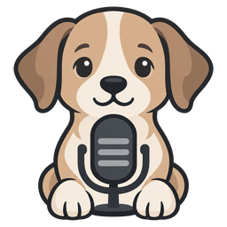

<p align="center"></p>

# Dogspeak

An **editor-first local dictation scratchpad and prompt design lab**. Dictate freely, let **Clean up** turn the ramble into a clear prompt, edit it, and copy it to a coding agent. The desktop app uses GTK4/libadwaita, local Bark Clean speech recognition, and SQLite autosave. Dictation never leaves the computer; only the optional Clean up button sends the draft to a language-model provider you configure.

## Open the scratchpad

On the original ThinkPad checkout, dependencies and model assets are already present:

```sh
cd ~/Dev/dogspeak
./app.sh
```

For a fresh clone, follow [SETUP.md](SETUP.md) first. The native frontend runs with distro `/usr/bin/python3` and PyGObject. A separate project-venv Python worker loads the model once per session; editing stays responsive during startup and transcription. Startup can take roughly half a minute and the resident model process uses about 3.1 GiB of RAM.

### First-version workflow

- Edit the main draft and its title; changes save locally.
- **Record / Stop** or **Super+R** toggles capture (Ctrl+Shift+R also works inside the window). The same shortcut can
  be enabled globally; it records into the current draft without bringing the
  editor to the front.
- While recording, **Enter** stops and transcribes; **Escape** cancels and
  deletes the partial audio. Escape during transcription drops that result.
- A small status pill appears at the bottom of the screen, above whatever app
  has focus (even fullscreen): *Recording 0:07* → *Transcribing…* → *Saved*.
  While it shows Recording, Enter and Escape work from any app; they are
  released as soon as the job ends. See [the screenshot](docs/overlay.png).
- A recording started while another app has focus is added to the draft **and**
  copied, so you can paste it with Ctrl+V where you are. Nothing is pasted for you.
- If the global shortcut is pressed while the model is still loading, the pill
  says so and tells you when Dogspeak is ready; it never starts recording late.
- If the model worker crashes, press Record (or the shortcut) to restart it.
- Select **System default** or a specific microphone.
- After stopping, the transcript appends as a new paragraph. You can keep editing while it processes.
- **Copy all** or **Ctrl+Shift+C** copies the draft; ordinary selection/copy also works.
- **New draft / Ctrl+N** starts another draft without discarding the previous one; reopen saved drafts with **Ctrl+O**. The trash button on a draft in that list deletes it, with its saved transcripts, after you confirm.
- While Dogspeak runs, a microphone icon in the top bar ([screenshot](docs/tray.png)) offers Show Dogspeak, Start/Stop recording, New draft, Copy all and Quit. It turns red while recording and amber while transcribing. Closing the window only hides it; use the icon to bring it back.
- Import an existing WAV/FLAC to retry a recording. The original CLI is still available below.

Recording starts only on explicit action, never at app launch or as a deferred surprise after loading. Capture automatically stops at 115 seconds, below the engine's 120-second input limit. Closing the window hides the editor and keeps the model loaded; **Ctrl+Q** or Quit unloads the worker. There is no permanent background service or automatic login startup. No text is pasted or sent to another program automatically.

User data is separate from the checkout, under `$XDG_DATA_HOME/dogspeak` (normally `~/.local/share/dogspeak`). This includes the local database and original ASR text. `DOGSPEAK_DATA_DIR` overrides this for isolated testing. Finished or cancelled recordings are deleted. No user data is uploaded or committed.

### Application launcher and optional global shortcut

Install the launcher in your user account (no sudo):

```sh
/usr/bin/python3 desktop_install.py
```

Dogspeak will appear in the desktop application launcher. To additionally opt in to a GNOME **Super+R** global record toggle:

```sh
/usr/bin/python3 desktop_install.py --shortcut
```

This also installs the **Dogspeak Overlay** GNOME Shell extension (`gnome-extension/`) that draws the status pill and the top-bar icon. A GTK window cannot be kept above the focused app on Wayland, so the Shell has to draw it. GNOME only discovers a new extension at login: **log out and back in once** after installing. Until then (or if the extension is turned off) status falls back to a notification banner, and Enter/Escape only work inside the Dogspeak window. Re-run the command after pulling changes to the extension.

This preserves other custom shortcuts and refuses a conflicting custom binding. It does not take over Spokenly's shortcut. If Dogspeak is not running, the first invocation opens/loads it; recording is not queued while the model loads. The app must remain open (window may be hidden) for warm, ready-to-record use. You can also assign `~/Dev/dogspeak/app.sh --toggle-recording` in your desktop's shortcut settings.

## Clean up (optional, uses a model provider you choose)

Dictate freely, then press **Clean up** (Ctrl+Shift+L). A language model rewrites the draft into coherent text: repeated points merged, corrections kept, grammar fixed, nothing invented, names and identifiers untouched.

- **Purpose** (optional): leave it blank for general clean-up, or say what the text is for. The menu has presets (*Prompt for an AI agent*, *Essay*, *Email*, *Notes*) plus your last five typed purposes. A prompt purpose gets instruction-like structure: goal, context, requirements, what counts as done.
- The result **replaces** the draft. **Ctrl+Z** undoes it at once; **Revert** steps back through versions, and the version menu jumps to any of the last 20 kept per draft. Hand edits are saved as a version before you jump away, so nothing is lost.
- **Suggestions** from the same request appear in the side panel (toggle in the header). They are read-only; dismiss each with ×.
- While a clean-up runs the draft is locked and greyed; **Esc** cancels. A transcript that arrives meanwhile is kept after the cleaned text.

**Setup:** ☰ menu → **Settings** (Ctrl+,). Pick a provider (OpenRouter is the default; **Claude (Anthropic)**, OpenAI, Google Gemini, Groq, DeepSeek, Ollama on this computer, or any OpenAI-compatible address), paste an API key and a model name, and press **Test**. Claude uses an API key from the Claude Console (platform.claude.com), runs through Anthropic's official Python SDK in the project venv, and starts with `claude-opus-5-5`; `claude-haiku-5-5` is far cheaper. The test only checks the key and the model, so it costs nothing. The key is stored in the GNOME keyring, not in Dogspeak's files.

Only the Clean up button sends text off this computer: the draft and the purpose, to the provider you configured. Dictation stays local. See [PRODUCT.md](PRODUCT.md) for the design decisions.

## Existing CLI and measurements

```sh
# Interactive terminal recording (Enter starts/stops; q quits)
./run.sh listen

# Transcribe files; two ADDITIONAL repeats after the first inference
./run.sh transcribe samples/jfk.flac --threads 4 --repeats 2 \
  --json results/cli-benchmark.json
```

Multiple files share one loaded model. The CLI reports startup, first/repeat inference, audio duration, real-time factor, current RSS and lifetime peak RSS separately. It accepts nonempty finite audio up to 120 seconds, downmixes stereo and resamples to 16 kHz. For paths outside the checkout, pass absolute filenames. CLI recordings/results remain under the Git-ignored source directories; GUI data lives in the XDG data directory instead.

Public speech and the user's own speech have run on this ThinkPad. The user confirmed disfluency cleanup; this does not imply perfect names, technical vocabulary, or self-correction handling. [BENCHMARK.md](BENCHMARK.md) retains the initial CPU measurements and their limitations. Dictation and inference use local assets; model/processor downloads happen only during setup.

## Tests

```sh
./test.sh
```

This runs core/ASR tests in the inference venv, then native GTK tests under Xvfb using system Python. GUI bindings are intentionally not injected into the inference environment. Automated unit tests use isolated data and simulated hardware/model behavior where appropriate; real recognition and the PipeWire capture path are exercised separately with public speech. Never treat mocked output as proof of transcription quality.

## Verification

See [the verification report](docs/SCRATCHPAD-VERIFICATION.md) for real
native-app/worker/capture/persistence checks, the overlay, tray and Clean up
checks, and what has not been verified yet.

## Files and attribution

- [SETUP.md](SETUP.md): prerequisites, pinned downloads, offline assets, privacy.
- `upstream.json` / `fixtures.json`: source revisions, checksums, public fixture identities.
- `vendor/`: unchanged upstream loader, model card and attribution notice.
- `docs/`: public-sample benchmark evidence and app screenshots—no personal recordings/transcripts.
- `gnome-extension/`: the Dogspeak Overlay GNOME Shell extension (status pill, Enter/Esc while recording, clipboard, top-bar menu).
- `data/icons/`: the app icon at standard sizes (installed by `desktop_install.py`); `data/logo/`: the full-size original logo.

Model derivatives are CC-BY-4.0; retain `vendor/NOTICE`. A license for new Dogspeak application code has not yet been selected. Model weights, `.venv`, credentials, recordings, raw private results and user databases are not published.
