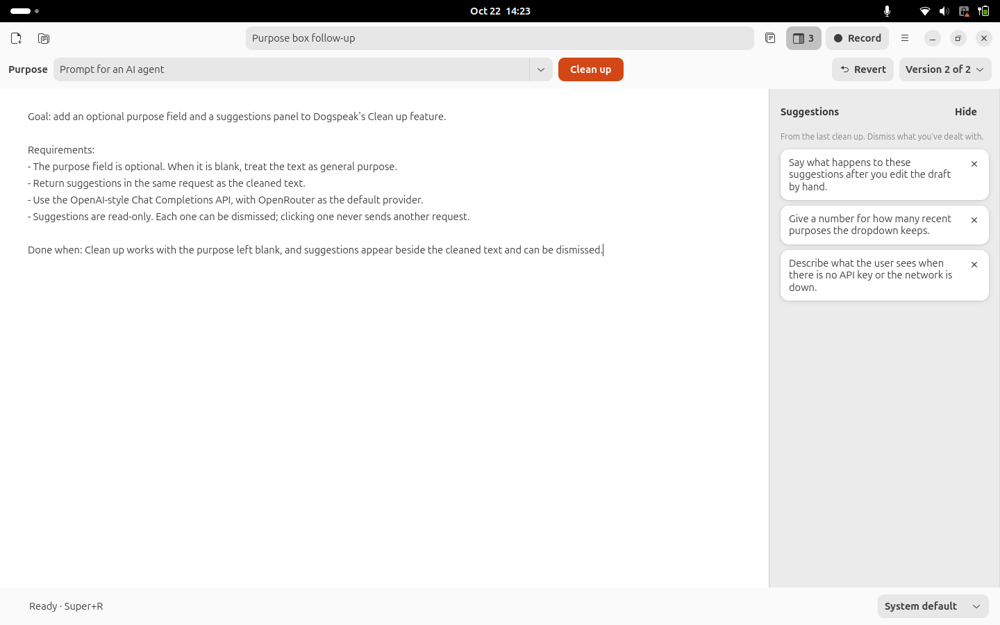

<p align="center"></p>

# Dogspeak

**Talk freely, get a clear prompt.** Dogspeak is a dictation scratchpad for Linux (GNOME). Speak the way you think, rambling, repeating yourself, changing your mind, and Dogspeak turns it into text you can edit and paste into a coding agent, an email or anything else.

- **Local speech recognition.** Dictation runs on your own computer with the [Underdog Bark 3.0 Clean](https://huggingface.co/ConwayResearch/Underdog-Bark-3.0-Clean) model, which also drops "um"s and false starts. No audio leaves the machine.
- **Record from anywhere.** Press **Super+R** in any app; a small pill at the bottom of the screen shows the recording, **Enter** stops it, **Esc** cancels. The text lands in your current draft and on the clipboard.
- **Clean up (optional).** One button sends the draft to a language model you choose (Claude, OpenRouter, OpenAI, Gemini, a local Ollama model, …) and turns it into a coherent, well-structured prompt, with suggestions on what's still missing. Every clean-up can be undone.
- **Drafts, not chats.** Several drafts, autosaved, with titles; nothing is sent or pasted anywhere unless you do it.



## Requirements

- **Linux with GNOME.** Developed and tested on Ubuntu 26.04 (GNOME 50, Wayland); GNOME on X11 should work but hasn't been tested. On other desktops (KDE, Xfce, …) the editor, recording and Clean up work, but the Super+R shortcut, the on-screen pill and the top-bar menu do not, because those are built on GNOME Shell.
- **About 4 GB of free RAM** while Dogspeak is open (the speech model stays loaded) and about 2 GB of disk.
- A microphone, and PipeWire (the default on current Ubuntu, Fedora and Debian).
- No GPU is needed; recognition runs on the CPU. A paragraph typically takes one to two seconds.

**Windows and macOS are not supported.** See [Porting](#porting-to-other-platforms) below for what it would take.

## Install

1. Install the system packages (Ubuntu or Debian; other distributions have equivalents):

   ```sh
   sudo apt install git python3-gi gir1.2-gtk-4.0 gir1.2-adw-1 gir1.2-secret-1 pipewire-bin
   ```

2. Install [uv](https://docs.astral.sh/uv/getting-started/installation/), the Python package manager Dogspeak uses for its speech-recognition environment. It fetches the right Python version by itself.

3. Clone and set up:

   ```sh
   git clone https://github.com/Remco28/dogspeak.git
   cd dogspeak
   ./setup.sh
   ```

   `setup.sh` builds the speech-recognition environment and downloads the model (about 180 MB), checking every file against the checksums in `upstream.json`. It is safe to run again.

4. Start it:

   ```sh
   ./app.sh
   ```

   The first start takes about half a minute while the model loads; you can type in the meantime.

5. **Recommended:** add Dogspeak to the app launcher and turn on Super+R, the on-screen pill and the top-bar menu:

   ```sh
   /usr/bin/python3 desktop_install.py --shortcut
   ```

   Then **log out and back in once**, so GNOME Shell loads the Dogspeak extension. Without `--shortcut`, only the launcher entry is added. The installer never replaces a shortcut another app already uses; it stops and tells you instead.

## Using Dogspeak

### Dictation

- **Record** (or **Super+R**, from any app) starts recording; press it again, or **Enter**, to stop. **Esc** cancels and throws the audio away.
- The transcript is added to the current draft as a new paragraph. You can keep typing while it's being transcribed.
- A recording started while another app has focus is also put on the clipboard, so you can paste it straight away. Dogspeak never pastes for you.
- Recordings stop automatically at 115 seconds. Audio files are deleted once transcribed.
- Choose a microphone at the bottom right, or leave it on **System default**.

### Drafts

- **Ctrl+N** new draft, **Ctrl+O** open a draft (the trash button deletes one, after asking), **Ctrl+Shift+C** copy the whole draft. Everything autosaves.
- Closing the window only hides it; the model stays loaded so the next recording is instant. Bring it back from the microphone icon in the top bar or the app launcher. **Ctrl+Q** (or *Quit* in either menu) exits and frees the memory.

### Clean up

Press **Clean up** (**Ctrl+Shift+L**) and the draft is rewritten: repeated points merged, corrections kept, grammar fixed, names and code left exactly as you said them, nothing invented.

- **Purpose** (optional): leave it blank for a general tidy-up, or say what the text is for. The menu offers *Prompt for an AI agent*, *Essay*, *Email*, *Notes* and your last five custom purposes. A prompt comes back structured as goal, context, requirements and what counts as done.
- The result replaces the draft. **Ctrl+Z** undoes it immediately; **Revert** and the version menu go back through the last 20 versions. Edits you made by hand are kept as a version too, so nothing is lost.
- **Suggestions** about what's missing or ambiguous appear in the side panel. They're for you to read; dismiss each with ×.
- While a clean-up runs the draft is locked; **Esc** cancels it.

**Setting up a provider:** open ☰ → **Settings** (**Ctrl+,**), pick a provider, paste an API key and a model name, and press **Test**. The test only checks the key and model; it costs nothing.

| Provider | Where to get a key | Model name examples |
|---|---|---|
| OpenRouter (default) | [openrouter.ai](https://openrouter.ai/keys), one key for many models | see [openrouter.ai/models](https://openrouter.ai/models) |
| Claude (Anthropic) | [platform.claude.com](https://platform.claude.com) | `claude-opus-5-5`, or `claude-haiku-5-5` for much lower cost |
| OpenAI, Google Gemini, Groq, DeepSeek | the provider's console | the provider's model list |
| Ollama on this computer | no key needed | any model you've pulled |
| Anything OpenAI-compatible | choose *Custom* and enter its address | |

API keys are stored in GNOME's password keyring, never in Dogspeak's files. Only the Clean up button sends anything off your computer: the draft and its purpose, to the provider you chose.

## Privacy

- Speech recognition is entirely local. Audio is deleted after transcription or cancellation.
- Drafts live in `~/.local/share/dogspeak` (a SQLite database readable only by you). Nothing is uploaded or synced.
- The model is downloaded once during setup; after that recognition works offline.
- Clean up is the only feature that uses the network, and only when you press it.

## Troubleshooting

- **No pill, no top-bar icon, Super+R does nothing:** run `desktop_install.py --shortcut` and log out and back in. Check that user extensions are switched on in GNOME's *Extensions* app. Until the extension loads, Dogspeak shows its status as notifications.
- **"Dogspeak is loading…" when pressing Super+R:** the model is still starting; press again in a moment. Dogspeak never starts a recording late on its own.
- **Super+R already used:** the installer refuses to take a shortcut another app owns. You can bind `/path/to/dogspeak/app.sh --toggle-recording` to any key in GNOME *Settings → Keyboard → Custom Shortcuts*.
- **Generic icon in the launcher:** run the installer again; it refreshes GNOME's icon cache.
- **Clean up fails:** the banner gives the reason (key rejected, out of credit, model not found, offline). **Test** in Settings checks the setup without spending anything.
- **Logs:** the speech worker writes to `~/.local/state/dogspeak/worker.log`.

## Porting to other platforms

The editor, drafts, version history, Clean up and the speech-recognition worker are plain Python and would carry over. Four pieces are Linux/GNOME-specific and would need a replacement per platform:

1. **Audio capture** uses PipeWire's `pw-record` (`dogspeak_app/audio.py`).
2. **The pill, Enter/Esc while recording, the clipboard hand-off and the top-bar menu** are a GNOME Shell extension (`gnome-extension/`), because Wayland doesn't let an app window stay on top. On Windows and macOS an always-on-top window and a tray icon do the job.
3. **The global shortcut** is a GNOME custom keybinding (`desktop_install.py`).
4. **API keys** use the Secret Service keyring (`dogspeak_app/credentials.py`); Windows and macOS have their own credential stores.

The window uses GTK 4 and libadwaita, which run on Windows and macOS but look out of place there; a serious port would probably switch toolkits. [ARCHITECTURE.md](ARCHITECTURE.md) describes the module boundaries.

## Development

```sh
./test.sh
```

runs the core tests in the project environment and the GTK tests headless (needs `xvfb`: `sudo apt install xvfb`). Tests use temporary data and stand-ins for the microphone, the speech model and the language-model providers; they never record or spend credit.

- [ARCHITECTURE.md](ARCHITECTURE.md): how the pieces fit together and why.
- [PRODUCT.md](PRODUCT.md): what Dogspeak is meant to be, and the decisions behind it.
- [SETUP.md](SETUP.md): what `setup.sh` does, step by step, and the pinned model versions.
- [BENCHMARK.md](BENCHMARK.md): speed and memory measurements of the speech model on a laptop CPU.
- [docs/SCRATCHPAD-VERIFICATION.md](docs/SCRATCHPAD-VERIFICATION.md): how the app was checked end to end, and what hasn't been.

A command-line tool is also included for testing the model directly: `./run.sh listen` records in the terminal and `./run.sh transcribe FILE…` transcribes audio files (`./run.sh --help` lists the options).

## License and credits

Dogspeak's code is released under the [MIT License](LICENSE).

The speech model is **Underdog Bark 3.0 Clean** by Conway Research, derived from NVIDIA's Parakeet TDT 0.6B v3 and Moondream's Parakeet Ultra, all under [CC-BY-4.0](https://creativecommons.org/licenses/by/4.0/). The model is downloaded during setup and is not part of this repository; its loader and notices are in `vendor/`, unchanged. Keep `vendor/NOTICE` with any redistribution.
