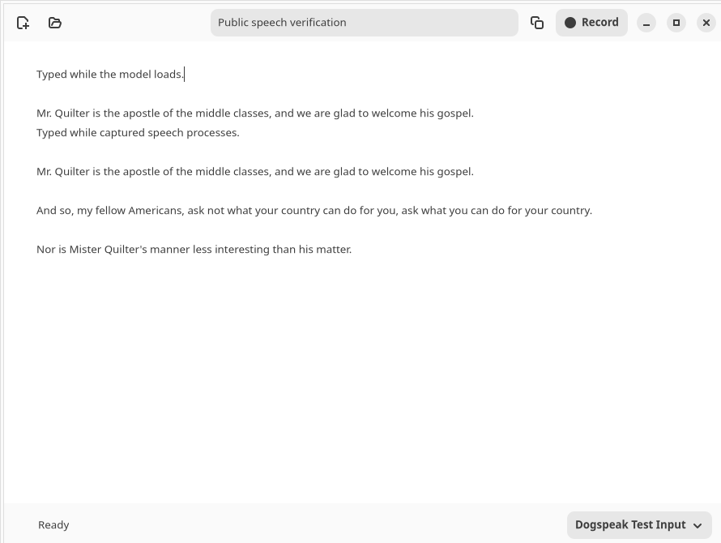

# First scratchpad verification

The first native GTK4/libadwaita scratchpad was exercised on the development laptop with
its real model worker and a private, isolated database. This is not a browser
mockup or a simulated ASR demonstration.

## Automated checks

- 56 core/CLI/storage/audio/worker/launcher tests passed.
- 17 controller/native GTK tests passed, including clipboard, undo, autosave,
  responsive recorder stop/shutdown, draft switching and two-process D-Bus
  command forwarding.
- `./test.sh` separates venv ASR dependencies from distro GTK bindings.
- Distro PyGObject deprecation warnings are filtered by module in the test
  runner; the headless rendering environment may still emit an EGL warning.
  They were not test failures and no system GTK package was upgraded.

## Real end-to-end exercise

A native application instance ran under an isolated Xvfb display/session bus,
using the actual `.venv` inference worker and local weights. Test UI ticks
continued during loading, capturing and inference. A temporary PipeWire
loopback provided `dogspeak.test.source` / `dogspeak.test.sink`; only public
LibriSpeech/JFK audio was played into it. The physical default microphone was
not selected for this automated recording test.

Verified:

1. A second `app.sh --import-audio ...` process forwarded to the existing app.
   Typed text remained intact while the worker loaded and appended its result.
2. Explicit record → play public speech into the chosen virtual source → stop
   finalized a valid WAV, transcribed intelligible speech and appended it.
3. Typing during actual transcription survived; the recorder child was reaped.
4. Switching to a new draft while an actual ASR job was pending did not route
   the result into the new document. Reopening the origin showed its result.
5. An invalid audio file produced a visible error without changing the draft.
6. Another valid file succeeded using the same worker after that error.
7. Normal window close reaped the worker. Reopening SQLite matched the editor
   text exactly.

The recorded public sentence was:

> Mr. Quilter is the apostle of the middle classes, and we are glad to welcome his gospel.

The app's recorder handles a PipeWire behavior seen on the development machine, where deliberate
SIGINT may return status 1: that status is accepted only after intentionally
stopping a running process and validating a finalized, nonempty WAV. Early
capture failures and truncated output remain errors. The old CLI has a
regression test for this behavior as well.

## Actual rendered interface

This screenshot comes from the real app and model exercise, not fabricated
transcription or a UI design mockup. The test input selector is temporary;
ordinary use selects the user's desired microphone or System default.

## Desktop scope and remaining acceptance

The per-user `.desktop` launcher was installed and passed
`desktop-file-validate`. Its contents were read back. The existing GNOME custom
shortcut list was unchanged; Super+Shift+D (since changed to Super+R) registration is opt-in through
`desktop_install.py --shortcut`. App-local actions/shortcuts and remote command
forwarding were tested; an actual GNOME global keypress was not claimed.

Real dictation had already confirmed filler removal. Further daily use is
still needed to judge vocabulary, corrections and UI ergonomics. This first
scratchpad had no language-model clean-up, cloud request, startup service or
automatic text sending; Clean up came later and is covered below.

## Later additions (2026-10-21)

Each was exercised with the real app inside an isolated, headless GNOME Shell
50 session (its own D-Bus and settings, never the user's desktop), using the
real model worker where speech was involved and public speech played into a
temporary PipeWire loopback source.

- **Overlay pill:** drawn above a fullscreen app that kept focus; Enter
  stopped the recording without reaching that app; Esc cancelled; the
  transcript was appended and copied; the Shell released Enter/Esc when the
  job ended and again when the client process exited.
  [Screenshot](overlay.png).
- **Top-bar menu:** appears while the app runs; Start/Stop recording, Copy all,
  Show and Quit all drive the real app; the icon turns red/amber while
  recording/transcribing. [Screenshot](tray.png). Quit was found not to exit
  the process (fixed, with a regression test).
- **Clean up:** against a local stand-in for an OpenAI-compatible provider,
  the request carried the purpose and fenced draft, the text was replaced as
  one undoable step, versions and suggestions appeared, and the layout matched
  the reviewed mockup. The real GNOME keyring stored, returned and cleared a
  throwaway key.
- **Claude provider:** the official `anthropic` SDK was exercised against a
  local stand-in API: structured output, low effort, refusal fallback on the
  larger models, model lookup for the free test, and plain-language errors.

Not yet verified: output quality from a real language model (no API key was
available during development), and the overlay/top-bar extension on the
developer's own session before the post-install logout and login (since
confirmed working).
